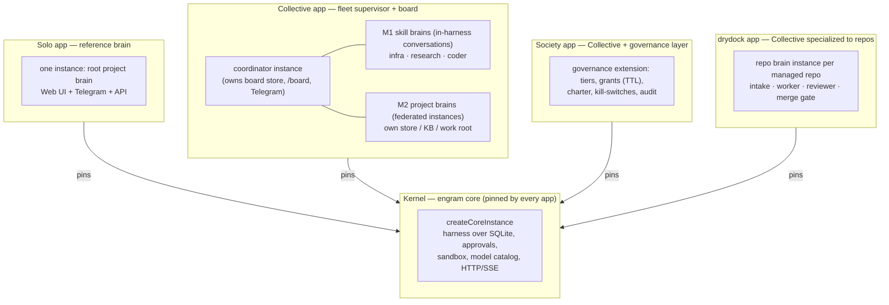
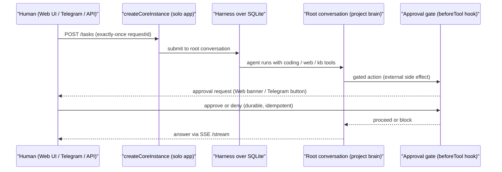
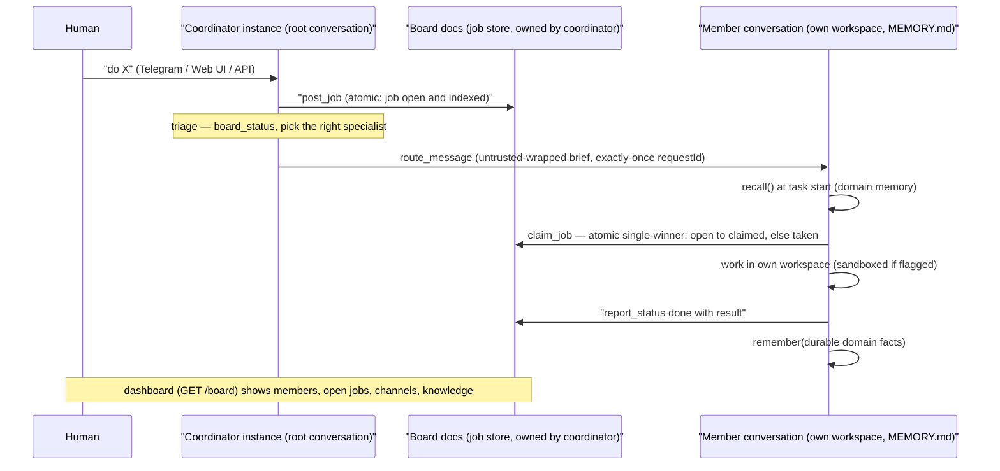
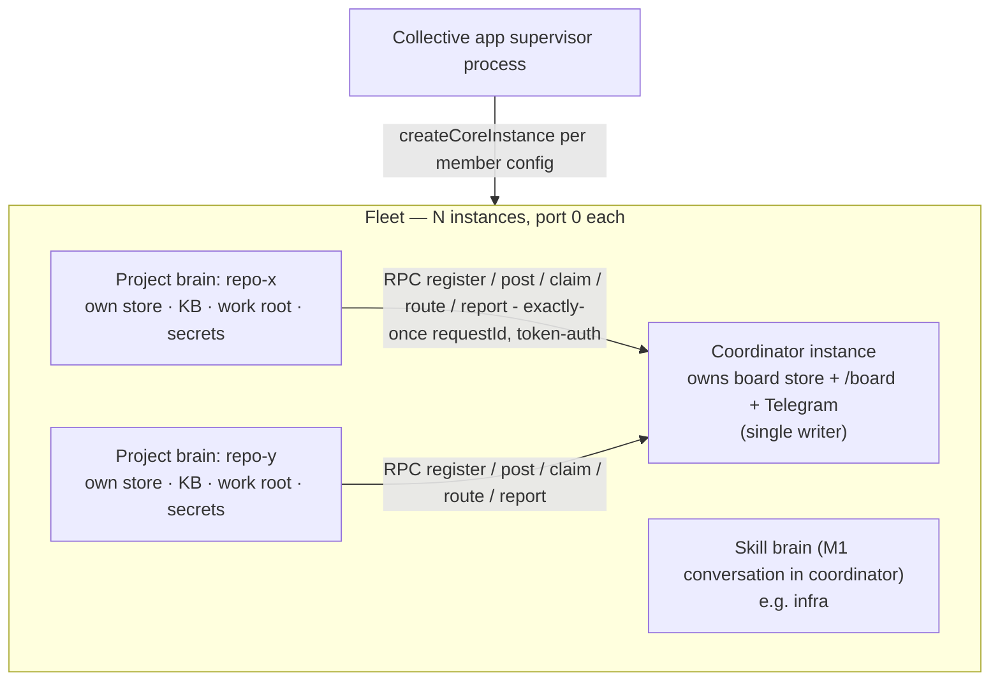
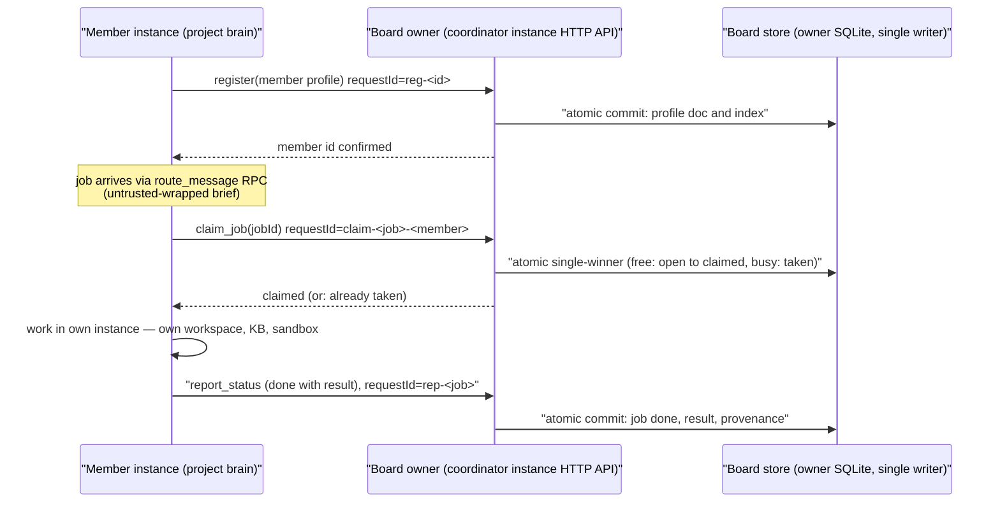
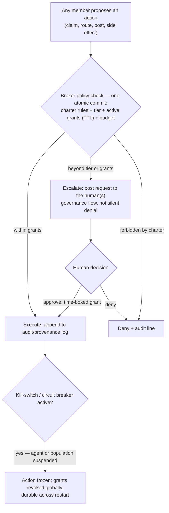
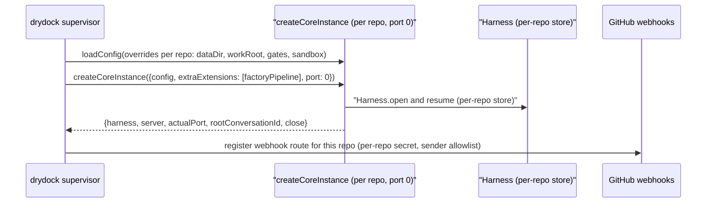
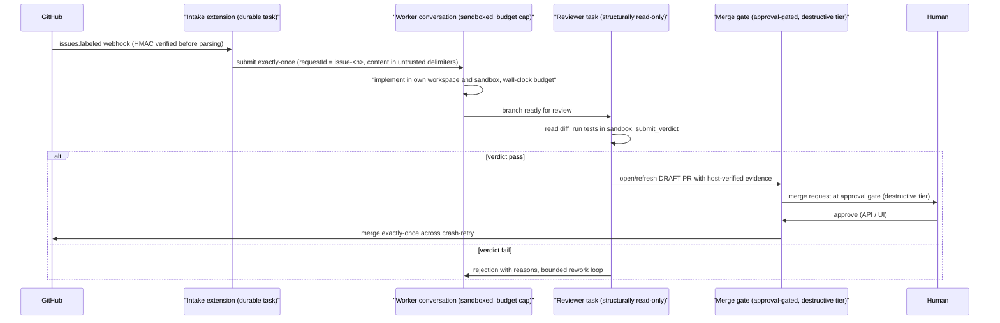

# Ecosystem Flows — Solo · Collective · Society · Drydock

**Status:** working reference for the ecosystem under the **fleet paradigm**. Supersedes the flow
sections of [`product-core-split.md`](product-core-split.md) (which remains the PR #43 record for the
seam API). Companion research: [`research/engram-ecosystem.md`](research/engram-ecosystem.md),
[`research/society.md`](research/society.md); plans: [`plans/collective.md`](plans/collective.md),
[`plans/society.md`](plans/society.md).

---

## 0. The approach — a kernel and its apps

The ecosystem is one **kernel** (the engram core) and several **apps** that compose it by pinning
it and calling `createCoreInstance()`. No app's machinery lives inside the kernel; the kernel knows
nothing about boards, fleets, charters, or factories.

| Layer | Where | What it owns |
|---|---|---|
| **Kernel** | `app/src/core.ts` + internal modules (`registry`, `server`, `sandbox`, `model`, `config`) | Durable runtime: harness over SQLite, exactly-once submissions, documents, approval machinery (`beforeTool` gates + allow-rules + destructive guard), sandbox manager, model catalog, HTTP/SSE server, deterministic teardown |
| **Apps** (one product per composition) | In-repo: the solo executable (`app/src/main.ts`). Out-of-repo: [lalanikarim/collective](https://github.com/lalanikarim/collective) (the flagship — shared board + remote members), drydock, future Society tooling | A fleet supervisor and/or a single instance plus its own client surfaces (dashboards, Telegram commands, webhooks). Installed in-harness via `extraExtensions`; persona via `rootAgent`/`rootInit` |
| **Upstream clients** | Any process over the HTTP API | Observe/administer: governance consoles, audit explorers, per-role approval clients. Never mutate durable state directly |

### Members have two tiers — a conversation or a brain

"Collective means multiple project/skill-based brains." In this paradigm a *member* is either:

- **M1 — in-harness skill brain.** A named standing *conversation* inside one instance: own
  workspace, model, domain memory (`MEMORY.md`), tools. Cheap; coordination is atomic in-process.
  This is what Collective A1–A4 shipped.
- **M2 — federated project brain.** A member that is **itself an engram instance**: own process or
  slot in the fleet, own store, KB, work root, secrets. A project/skill brain with real isolation.

The **board owner** (the coordinator instance) is the *single writer* of the board store. M2 members
never touch that store; they call the board owner over HTTP — register / post / claim / route /
report — each request exactly-once by `requestId`, and the owner performs the durable commit.
Federation is therefore **RPC to the board owner, not doc sync between peers** (invariant: one
process owns one store).

The member abstraction seam is what makes M1→M2 a deployment change, not a rewrite: members are
addressed by id through register/post/claim/message; "local conversation now, remote instance
later." The board schema is identical in both tiers.

### What is new vs. reused

| Piece | Status |
|---|---|
| Board docs (profiles / jobs / channels / knowledge), trust gates, untrusted wrapping, revoke | Reused unchanged — schema identical M1/M2 |
| Per-brain isolation, model pooling, own KB/workspace | Free from `createCoreInstance` per instance |
| Fleet supervisor (boot N instances with per-member config) | Small — the drydock supervisor pattern already exists |
| **Remote member transport** (board-owner HTTP API + client side of post/claim/route/report) | **The one genuinely new mechanism** — exactly-once over HTTP, cross-process crash semantics, instance auth |
| Route seam in core (apps register their own HTTP routes) | **Shipped** — `createCoreInstance({ routes })`; `/board` now registers from the product layer; drydock webhooks benefit too |

### Invariants that must survive every app

1. **Durability & exactly-once** — crash-safe; no duplicate side effects (including over federation RPC).
2. **Human is the control boundary** — every external side effect routes to an approval gate; no self-approval.
3. **Isolation** — untrusted/generated code sandboxed; secrets never leak into transcripts or across member trust domains.
4. **Local-first, LAN-only** exposure.
5. **One process owns one store.** Cross-instance coordination goes through the board-owner RPC seam, never shared SQLite.
6. **Untrusted peer input** — peer/web content is delimited data with provenance, never instructions. At M2 this is security-critical (real network trust boundary), not hygiene.

---

## 1. Flow 1 — the Solo engram unit

One instance, one human, no board. The reference product: a durable project brain.

| Concern | Layer | Why |
|---|---|---|
| Harness lifecycle, registry, sandbox, server, approval machinery | Kernel | Atomic/runtime-level; shared by all apps |
| Root persona + client wiring (Telegram) | Solo app | Persona and surfaces are product decisions |
| Any future custom endpoints | App-registered routes via the route seam | Kernel stays board/factory-free |

**Boot:** `createCoreInstance({ config, rootAgent })` — no `extraExtensions`, no board. This is what
drydock's bare instances run today; it is also the fallback for anyone who wants just a brain.

---

## 2. Flow 2 — the Collective (a fleet of project/skill brains)

The Collective app is a **fleet supervisor**: it boots N instances (one process, `port: 0` each, or
N supervised processes), one of which is the **coordinator** that owns the board store and the
client surfaces. Members are M1 skill brains in-harness and/or M2 project brains as federated
instances.

### 2a. M1 — skill brains in-harness (shipped, A1–A4)

Key properties that keep M1 in-process: `claim_job` single-winner is a read-check-write across
`board.job` + `jobIndex` in one atomic commit; governance checks (`canPostJobInTx`, `canRouteInTx`)
run *inside* the commit they gate; peer message bodies are delivered as `<untrusted ...>` data.

### 2b. M2 — project brains as federated instances (the new tier)

Properties that make M2 safe:

- **Single writer preserved.** All board mutations commit inside the owner; members are RPC clients.
  Crash-retry of an RPC is deduped by `requestId` — same exactly-once discipline as in-process.
- **Isolation for free.** Each project brain has its own process/store/secrets/sandbox; a compromised
  member cannot read another member's secrets or the coordinator's transcripts (containment upgrades
  from A3's per-conversation sandbox to real trust-domain separation).
- **Untrusted-peer discipline becomes security-critical.** Peer content crosses a network boundary
  between trust domains — `<untrusted>` wrapping and tier checks are load-bearing, not hygiene.
- **Model pooling per instance.** Cheap models for monitoring brains, strong models for high-stakes
  work; idle brains cost ~zero inference (event-driven wake).
- **Choke-point tradeoff.** The coordinator is the board store + all federation traffic — keep it
  minimal, LAN-only, no member secrets in it, human can freeze it durably.

**M1→M2 migration** of a member is a deployment change: same profile doc, same job schema; the
transport behind "address by id" swaps from local conversation to instance endpoint.

---

## 3. Flow 3 — the Society (governance layer over the fleet)

Society is **the same fleet shape plus a governance extension** composed alongside the board:
tiered clearance (T0 data-only → T1 propose → T2 initiate within grants), per-capability grants with
scope + TTL, a durable charter enforced at the broker, self-initiated *proposals*, kill-switches,
and append-only audit. Promotion is human-approved; outcomes are signal only.

Placement: the governance layer is an **app-layer extension package** (in-harness, atomic — same
reason board must be), not kernel code. The only anticipated kernel change across all of Society is
B6's multi-human approval routing (per-role approvers); everything before B6 composes over the
existing `beforeTool` hook + doc machinery.

**Self-initiation (the largest drift from Collective):** an agent may *propose* a job within its
scope, but **initiation ≠ side effects** — executing anything with an external side effect still
routes to the human approval gate at every tier. Autonomy produces proposals; the control boundary
is preserved at the action level. Proposals carry provenance (initiator + tier at the time).

**Revocation:** durable and immediate — suspend any agent or the whole population; freeze pending
actions; revoke grants globally. A revoked member is frozen regardless of tier (carried from A3).

---

## 4. Flow 4 — drydock (a Collective specialized to software repos)

Drydock is the paradigm's proof that it generalizes: a fleet supervisor running **one engram
instance per managed repo**, each a project brain with its own factory pipeline (intake → worker →
reviewer → merge gate). It *is* a bounded team of named brains serving one human — just specialized
to repos, with the merge gate as the destructive-tier human control boundary.

Drydock relies on the seam exactly as designed: `extraExtensions` for the pipeline, `port: 0` +
`actualPort` for N instances per box, `loadConfig(overrides?)` for per-repo config, `close()` for
teardown/redeploy, and the kernel's approval machinery for the merge gate (the invariant is enforced
by engram, not re-implemented by drydock). It SHA-pins the kernel and re-runs its acceptance gates on
every bump.

---

## 5. Placement & invariants reference

### Placement decision rules (updated)

1. Needs atomicity against a store or other conversations? → **kernel**, or an extension installed
   into that store's instance.
2. Needs model access, tools, or durable state inside this instance? → **app-layer extension** via
   `extraExtensions`.
3. Only reads/writes through public primitives (API, SSE)? → **upstream client**.
4. Consequential side effect from any layer? → register it as an **approval-gated tool**; never
   bypass the gates mechanism.
5. New HTTP endpoint for this app? → **app-registered route** via the route seam — never a kernel
   special case.

### Security invariants (must survive any composition)

1. The human is the control boundary — every external side effect routes to an approval gate.
2. Destructive-tier actions can never be auto-approved or covered by an allow-rule.
3. Peer/external content is untrusted data with provenance — never instructions; load-bearing at M2.
4. `extraExtensions` run with full core privilege: vet them like first-party code.
5. One process owns one store. Cross-instance coordination goes through the board-owner RPC seam,
   never shared SQLite.

### Open work this paradigm implies (in dependency order)

1. ~~**Route seam in kernel**~~ — **done**: `createCoreInstance({ routes })` / `ServerDeps.routes`; `/board` now registers from the product layer (`main.ts`), the kernel is board-free.
2. ~~**Reframe `app/` as the Collective app**~~ — **done**: READMEs, module headers, and repo docs now name it as such; the board is documented in `app/README.md`.
3. ~~**Remote member transport (M2)**~~ — **done** (M2.1 2026-10-27, M2.2 2026-10-28): remote members on
   other instances (`endpoint` + `tokenRef`, tokens only in the board owner's `BOARD_PEER_TOKENS`
   env); `route_message` dispatches to the peer's `/tasks` — exactly-once by requestId,
   fire-and-forget on 202, untrusted-wrapped inbound. M2.2 adds the board-owner RPC API
   (claim/report/route-back) + the thin board-client extension so remote members join the work loop.
   Design and decisions: [`plans/m2-remote-members.md`](plans/m2-remote-members.md).
4. ~~**Extract the Collective into its own repo**~~ — **done** (2026-10-28): the board + M2 wiring
   moved to [lalanikarim/collective](https://github.com/lalanikarim/collective), which pins the kernel
   as an npm dependency (`engram` from git, `prepare` compiles `dist/`) and composes it via
   `createCoreInstance()`. The engram repo keeps the kernel + the solo executable; its root
   package wrapper exposes the exports map for consumers. Outbound comms on member instances stay
   disabled by default (selectively enableable per member).
5. **Governance extension (Society B1–B4)** — app-layer package composed alongside board; kernel change only at B6 if multi-human approval routing demands it.
