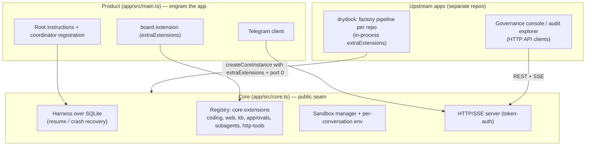
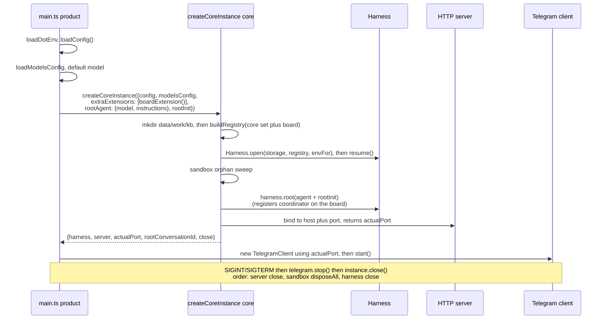
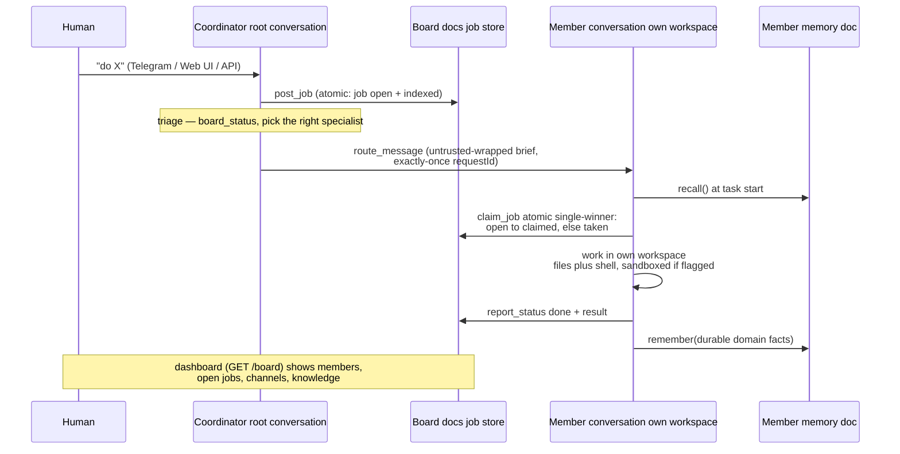
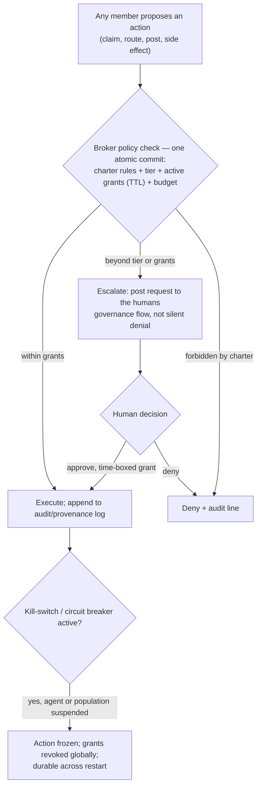
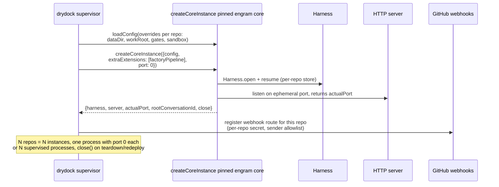
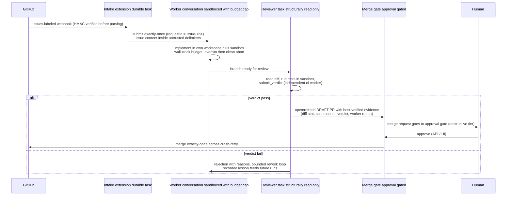

# Product/Core Split — Flows & Product-Engineer Reference

**Status:** reference documentation for [PR #43](https://github.com/lalanikarim/engram/pull/43)
(composable core instance, issue [#42](https://github.com/lalanikarim/engram/issues/42)).
Companion to [`research/board.md`](research/board.md) (Collective), [`research/society.md`](research/society.md)
(Society), and drydock's [`multi-repo-factory-plan.md`](https://github.com/lalanikarim/drydock/blob/main/research/multi-repo-factory-plan.md).

This document shows what the four flows look like **after** the product/core split, and serves as
the working reference for product engineers building on (or inside) the core.

---

## 1. The split at a glance

The engram codebase is now three layers:

| Layer | Where | What it owns | Examples |
|---|---|---|---|
| **Core** | `app/src/core.ts` + internal modules (`registry`, `server`, `sandbox`, `model`, `config`) | Durable runtime: harness over SQLite, registry assembly, per-conversation env/sandbox, HTTP/SSE server, model catalog, deterministic teardown | `createCoreInstance()`, `buildRegistry()`, `loadConfig()` |
| **Product** | `app/src/main.ts` + product extensions (`board`, Telegram client, root instructions) | One particular composition of the core: *engram the app* — project brain + board + Telegram | coordinator registration, `ROOT_INSTRUCTIONS`, Telegram bridge |
| **Upstream apps** | Separate repos/processes (drydock, future Society tooling) | Domain logic composed over the core (in-process via `extraExtensions`) or over the HTTP API | drydock's factory pipeline per managed repo |

**The seam.** `createCoreInstance()` is the only sanctioned in-process composition point:

```ts
const instance = await createCoreInstance({
  config,                          // AppConfig — from loadConfig(overrides?)
  modelsConfig,                    // optional; loaded internally if omitted
  extraExtensions: [myExt],        // plain pi-durable extensions, installed before Harness.open
  host: "127.0.0.1", port: 0,      // port 0 = ephemeral; actual port returned
  rootAgent: { model, thinkingLevel, instructions },
  rootInit: async (tx, convId) => { /* runs inside the root-creation commit */ },
});
// → { harness, server, actualPort, rootConversationId, close }
```

**The placement rule (use this for every "where does X go?" decision):**

> Anything that must be **atomic against the durable store or other conversations** lives in the
> core (or an extension installed into it). Anything that **composes those primitives for a
> specific domain** is a product layer or an upstream app.

- Atomic multi-doc transactions, cross-conversation submission with exactly-once requestIds,
  identity/governance checks evaluated *inside* the commit they gate → **core/extension**.
- UIs, integrations, per-domain orchestration that only reads/writes through public primitives →
  **product or upstream app over the API**.



---

## 2. Flow 1 — engram as a product

### Boot sequence

`src/main.ts` is now pure composition. The product decides *what engram is*; the core does the
mechanics:



### Runtime request path (unchanged by the split)

- **In:** `POST /tasks` (Web UI, API clients) or Telegram long-poll → exactly-once submission to a
  conversation (`requestId`).
- **Work:** the conversation's agent runs with its configured tools; external side effects hit the
  approval gate (`beforeTool` hook + risk tiers + allow-rules + TTL) and block until a human decides
  via `POST /approvals/:key` or an inline Telegram button.
- **Out:** SSE `/stream` (cursor-based reconnect) delivers progress/answer; the Web UI approvals
  panel and Telegram buttons settle decisions idempotently (409-safe).

### Product vs. core mapping (this flow)

| Concern | Layer | Why |
|---|---|---|
| Board tools + coordinator registration | Product (`extraExtensions` + `rootInit`) | A capability of *engram the app*, not of the generic core — consumers don't inherit it |
| Root "project brain" instructions | Product (`rootAgent.instructions`) | Persona, not mechanism |
| Telegram bridge | Product | One client surface; other surfaces are upstream apps |
| Registry assembly, harness lifecycle, sandbox, server, approvals machinery | Core | Must be atomic/runtime-level; shared by all compositions |

---

## 3. Flow 2 — the Collective (Option A)

**Composition note:** the Collective is a *product-layer composition* over the same core — the
board extension plus a coordinator root agent. It ships inside the engram product today, but any
consumer can compose an equivalent collective by passing `boardExtension()` in `extraExtensions`
and registering its own coordinator in `rootInit`. Nothing about it required core changes; that is
the split working as intended.

### Job lifecycle (triage → claim → work → report)



Key properties that force this to stay in-process (see the placement rule):

- **`claim_job` single-winner** — read-check-write across `board.job` + `jobIndex` in one atomic
  commit; impossible to reproduce race-free over HTTP.
- **`route_message` delivery** — cross-conversation submission with a stable
  `sha1(sender|target|content)` requestId for crash-retry dedup.
- **Identity at commit time** — "who am I" resolves from a conversation-scoped doc; governance checks
  (`canPostJobInTx`, `canRouteInTx`) run *inside* the same commit they gate.

### Trust and containment (A2/A3)

- Members route only to ids on their `allowedTargets` allowlist; coordinator + human bypass.
- Peer message bodies and knowledge posts are delivered as `<untrusted ...>` data — never instructions.
- A disabled member is frozen atomically (cannot claim, route, post, or remember); only the human or
  an active coordinator can disable/enable (`disable_member` / `enable_member`).

---

## 4. Flow 3 — the Society (Option B, planned)

**Status:** research with confirmed decisions (trust model, autonomy boundary, sequencing — see the
decision log in [`research/society.md`](research/society.md)); **not built**. Everything below is the
*intended* flow once the layers land: grants/charter → self-initiation → safety controls →
multi-human → scale.

Society is "Collective at scale + more autonomy": an open population of agents with tiered clearance,
TTL grants, a durable charter enforced at the broker, self-initiated *proposals*, and kill-switches.
It generalizes the core's approval machinery — **A gates specific tools; B gates actions against
policy** — which is why it must live in the core, not as an upstream app.

### Action gating at the broker (the central flow)



### Self-initiation (the largest drift from A)

An agent may **propose** a job within its scope — but *initiation ≠ side effects*: executing anything
with an external side effect still routes to the human approval gate. Autonomy produces proposals;
the control boundary is preserved at the action level. Proposals carry provenance (initiator + tier
at the time) for audit.

### Promotion and revocation

- **Promotion is human-approved**, never automatic. Outcome signals (jobs done, approvals granted/
  denied, incidents) inform the decision but are not an autonomous grantor.
- **Revocation is durable and immediate** — `suspend` any agent or the whole population; freeze
  pending actions; revoke grants globally.

### Federation (M2) — the only genuinely separate-project piece

When the population spans boxes, each box remains a **full engram core** (its own process, store,
model). Remote members join through the member-abstraction seam (address by id; register/post/claim/
message), which becomes an API-level *federation protocol between cores*. The board store schema is
identical in M1 and M2 — migrating a member to its own instance is a deployment change, not a rewrite.

### Placement table (Society)

| Concern | Layer | Why |
|---|---|---|
| Charter doc, tier/grant docs, broker action-gating hook, kill-switches, budgets, provenance/audit | **Core** (board extension graduates to a governance layer) | Must be atomic with the actions they gate; single-writer store |
| Governance console (charter review, promotions, revocation UI), per-role approval clients, audit explorer | **Upstream apps over the API** | Observe/administer; never mutate state directly |
| Remote-member federation protocol | **Separate project** (between cores) | Each instance keeps its own durable store |

---

## 5. Flow 4 — drydock (external consumer)

**Model:** one engram instance per managed repo. Drydock's factory pipeline (worker/reviewer tasks,
merge gate, webhook intake, budgets) is composed **in-process** via `extraExtensions` — nothing
factory-specific moves upstream into engram. This is the seam's first real consumer and the reason
issue #42 exists.

### Instance boot (fleet shape)



### Issue → reviewed PR pipeline (inside one instance)



### Which seam features drydock relies on

| Seam feature | Used for |
|---|---|
| `extraExtensions` | Factory pipeline tasks/tools (worker, reviewer, merge gate, intake) installed before `Harness.open` |
| `port: 0` + `actualPort` | N instances per process/box without port collisions |
| `loadConfig(overrides?)` | Per-repo data dirs, work roots, gates, sandbox settings — no env juggling |
| `close()` | Deterministic teardown for redeploy and tests; idempotent |
| Approval gates (core machinery) | The merge gate registers as a destructive-tier gated tool — the human owns the merge, enforced by engram's existing invariant, not re-implemented by drydock |

**Pinning discipline:** drydock SHA-pins engram and re-runs its full acceptance-gate suite on every
bump. The stability contract in `src/core.ts` (lifecycle + injection point stable; config additive)
is what makes that loop cheap.

---

## 6. Product-engineer reference

### `createCoreInstance` API

| Option | Type | Default | Notes |
|---|---|---|---|
| `config` | `AppConfig` | — | From `loadConfig(overrides?)`; per-instance data/work/kb dirs, gates, sandbox |
| `modelsConfig` | `ModelsConfig` | loaded internally | Pass to skip discovery (tests, pinned catalogs) |
| `extraExtensions` | `readonly Extension[]` | `[]` | Plain pi-durable extensions; installed after the core set, before `Harness.open`. **Full core privilege** — treat like first-party code |
| `host` / `port` | `string` / `number` | `config.host` / `config.port` | `port: 0` = ephemeral; use `actualPort` for anything derived (e.g. client API URLs) |
| `rootAgent` | `AgentChange` | catalog default model, thinking `medium` | Persona/instructions/tools for the root conversation |
| `rootInit` | `(tx, convId) => Promise<void>` | none | Runs **inside** the root-creation commit — durable, exactly-once |

**Returns** `{ harness, server, actualPort, rootConversationId, close }`.

**`close()` semantics:** idempotent; order is server close → sandbox `disposeAll` → harness close.
The HTTP port is released before it resolves (verified by rebind in `test/core-instance.test.ts`).
It does **not** call `process.exit` — the product layer owns process lifecycle.

### Placement decision rules

1. Needs atomicity against the store or other conversations? → **core/extension**.
2. Needs to run with model access, tools, or durable state inside this instance? → **extension** (product's or consumer's, via `extraExtensions`).
3. Only reads/writes through public primitives (API endpoints, board docs via API, SSE)? → **upstream app**.
4. Consequential side effect from any layer? → register it as an **approval-gated tool**; never bypass the gates mechanism. The "human is the control boundary" invariant must survive into consumer extensions.

### Stability contract (what consumers may rely on)

- Stable across versions: instance lifecycle (`open`/`resume`/`close`), the `extraExtensions`
  injection point, return shape of `createCoreInstance`.
- Additive: `AppConfig` fields and options may be added.
- Breaking changes to the seam: major version bump + deprecation window (even in 0.x), documented in
  the module header and README.
- Everything else in `src/` is **internal** — consumers import only `core.ts` (+ `config.ts`).

### Testing patterns (from `test/core-instance.test.ts`)

- **Hermetic env:** live-model tests must set `process.env.OPENAI_BASE_URL ??=` /
  `OPENAI_API_KEY ??=` from their resolved values — pi-ai's env provider resolves the key from
  `process.env` at *generation* time, not from discovery-time values.
- **Ephemeral ports:** always `port: 0` in tests; assert on `actualPort`.
- **Teardown proof:** call `close()` twice (idempotence), then rebind the same port with a plain
  server (release proof).
- **Multi-instance:** two instances in one process with distinct configs; assert no cross-instance
  extension/state leak and distinct ports.

### Security invariants (must survive any composition)

1. The human is the control boundary — every external side effect routes to an approval gate.
2. Destructive-tier actions can never be auto-approved or covered by an allow-rule.
3. Peer/external content is untrusted data with provenance — never instructions.
4. `extraExtensions` run with full core privilege: vet them like first-party code; a compromised
   extension is a compromised instance.
5. One process owns one store. Cross-box coordination goes through the federation seam, not shared
   SQLite.

---

*Generated as part of PR #43. Diagrams in this file are validated mermaid; the HTML edition
(`product-core-split.html`) is self-contained with the diagrams inlined as SVG.*
